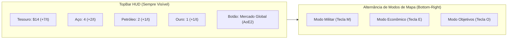

# Hegemonia — Documento de Game Design: Economia de Guerra, Recursos, Unidades, Construções e Balanceamento Continental

> **Status:** Especificação de Game Design (Proposta Consolidada)  
> **Escopo:** `@hegemonia/shared`, `@hegemonia/maps`, `@hegemonia/engine`, `@hegemonia/server`, `@hegemonia/web`  
> **Referências Plane:** `HEGEM-18` a `HEGEM-35`, integrado com sistemas já implementados (`HEGEM-20`, `HEGEM-21`, `HEGEM-23`, `HEGEM-24`, `HEGEM-36`, `HEGEM-50`, `HEGEM-51`, `HEGEM-53`, `HEGEM-55`).

---

## 1. Visão Geral & Filosofia de Design

O objetivo desta evolução mecânica é transformar o **Hegemonia** de um jogo de conquista puramente numérico (estilo *War/Risk* clássico) em um **wargame geopolítico e geoeconômico profundo**, inspirado em *Hearts of Iron IV* (recursos estratégicos, combustível e indústria) e *Age of Empires II* (mercado global dinâmico com oferta e demanda), mantendo partidas ágeis com turnos de **120 segundos** e **100% de determinismo** no motor (`@hegemonia/engine`).

### Princípios Fundamentais
1. **Assimetria Complementar entre Continentes:** Nenhum continente possui todos os recursos em abundância. Regiões ricas em indústria e aço (como Europa e Leste Asiático) têm déficit crítico de petróleo, forçando comércio internacional, diplomacia ou guerras por recursos no Oriente Médio, África, Oceania ou Américas.
2. **Início Suave Garantido:** Todo jogador começa com uma renda base garantida pela sua **Capital (+3 Dinheiro/turno)**, evitando travamentos econômicos nos primeiros turnos, independentemente do sorteio inicial de territórios.
3. **Zero Microgerenciamento Desnecessário:** Em vez de peões civis móveis que poluem o mapa e consomem o relógio de 120s, a extração e o comércio de recursos operam via **Domínio Territorial + Construções (Indústria/Mercado) + Acordos de Fronteira**.
4. **Clareza Visual Absoluta:** Separação estrita entre **Modo de Mapa Militar** e **Modo de Mapa Econômico**, garantindo leitura limpa tanto no combate quanto na gestão de infraestrutura.

---

## 2. Moeda e Recursos Estratégicos

O sistema econômico abandona o uso genérico de "Ouro" como moeda básica (que constava nas tasks antigas do Plane) e adota **1 moeda corrente líquida** + **3 recursos estratégicos físicos**:

| Recurso / Moeda | Ícone / Tipo | Função Principal | Fontes de Obtenção |
| :--- | :--- | :--- | :--- |
| **Dinheiro (`$`)** | Moeda Corrente (Tesouro Nacional) | Construir estruturas, recrutar unidades especiais, pagar manutenção militar e negociar no Mercado Global. | • **Capital:** `+3$/turno` (base fixa) • **Mercado:** `+2$/turno` • **Indústria:** `+2$/turno` (em regiões sem recurso bruto) • **Estreitos/Hubs Comerciais:** `+1$` a `+2$/turno` • **Ouro (passivo):** `+2$/turno` por jazida • **Venda de recursos / Rotas de Investimento** |
| **Aço** | Recurso Industrial Básico | Matéria-prima obrigatória para fabricar **Blindados (Tanques)**, **Artilharia**, **Aeronaves**, **Marinha** e **Fortalezas Nv. 2**. | • Jazidas naturais de Aço/Ferro (`+1/turno` base; `+2/turno` com Indústria) • Compra no Mercado Global ou Comércio de Fronteira |
| **Petróleo** | Recurso Energético / Combustível | Obrigatório para fabricar e **operar ofensivamente** **Blindados**, **Aeronaves** e **Marinha**. | • Poços naturais de Petróleo (`+1/turno` base; `+2/turno` com Indústria) • Compra no Mercado Global ou Comércio de Fronteira |
| **Ouro** | Recurso Estratégico Escasso (6 no mundo) | Dupla função: 1. Gera **+2$/turno** de riqueza passiva (ou alto valor de venda no Mercado). 2. Pode ser gasto diretamente na **Compra de Cartas de Suprimento Extras** (sem precisar conquistar território no turno) ou financiamento de operações especiais/diplomáticas. | • Apenas **6 jazidas históricas** no mapa mundial (`+1 Ouro/turno` + `+2$/turno`) • Compra no Mercado Global (muito caro) |

### Regra de Combustível ("Falta de Petróleo" estilo *HoI4*)
Unidades mecanizadas, aéreas e navais **não são destruídas** caso o estoque de Petróleo do jogador chegue a `0`. Porém, entram no estado **"Sem Combustível"**:
- **Blindados (Tanques):** Não podem realizar *Blitzkrieg* (avanço profundo) nem rerrolar dados `1` no ataque; lutam apenas como unidades defensivas comuns.
- **Aeronaves:** Ficam em solo no Aeródromo (não realizam ataques táticos, bombardeios estratégicos ou ponte aérea).
- **Marinha:** Permanece ancorada no Porto (perde a capacidade de projetar **Bloqueio Naval** ofensivo ou apoiar desembarques).

### Impacto de Golpe de Decapitação (`HEGEM-24`)
Integrado ao sistema de Capitais já existente no motor: perder a própria Capital aplica `economicPenaltyMultiplier = 0.5`, reduzindo pela metade a arrecadação líquida de **Dinheiro (`$`)** até a reconquista ou Reorganização Nacional (5 rodadas).

---

## 3. Extração de Recursos e Comércio de Fronteira (Substituição da "População Trabalhadora")

### Crítica de Design: Por que não usar "Trabalhadores" móveis?
Adicionar uma unidade civil separada que precisa ser comprada e movida pelo mapa em um jogo com turnos de 120s e 5 tipos de unidades militares geraria:
1. Poluição visual severa em territórios pequenos (Europa, Leste Asiático).
2. Microgerenciamento excessivo sob pressão de tempo.
3. Ambiguidade nas regras de combate (trabalhadores bloqueiam passagem? São capturados ou mortos?).

### Solução Mecânica: Extração Estrutural + Concessão de Fronteira
1. **Extração Base por Guarnição (`+1/turno`):** Todo território com recurso natural (Aço, Petróleo ou Ouro) que possua pelo menos 1 unidade militar controladora extrai automaticamente **`+1` unidade daquele recurso por turno** no início do turno do dono.
2. **Extração Industrializada (`+2/turno`):** Construir uma **Indústria** em um território com recurso natural representa a mecanização e força de trabalho especializada local, dobrando a extração para **`+2` daquele recurso por turno**.
3. **Comércio Direto de Fronteira (Ideia da Compra Adjacente):**
   - Se o Jogador A controla um território adjacente a um território produtor de recursos do Jogador B (e ambos não estão em guerra / possuem PNA ou Aliança), o Jogador A pode propor um **Contrato de Extração/Compra de Fronteira** (`trade_border_resource`).
   - **Vantagem:** Permite comprar Aço ou Petróleo diretamente do vizinho por um preço fixo negociado **sem precisar ter construído um Mercado** e sem sofrer a taxa de inflação do Mercado Global.
   - O vizinho recebe o Dinheiro (`$`) diretamente no seu tesouro, criando interdependência geopolítica local (ex.: Europa comprando Petróleo do Oriente Médio ou Norte da África; Brasil vendendo Aço para a Argentina).

---

## 4. Mercado Global (Estilo *Age of Empires II*) e Investimento Aliado

### 4.1. Acesso ao Mercado Global
- Para comprar ou vender recursos no Mercado Global, o jogador **precisa controlar pelo menos 1 construção de `Mercado`** em qualquer um de seus territórios.
- A Capital pode construir um Mercado logo no primeiro turno se o jogador desejar focar em comércio.

### 4.2. Precificação Dinâmica Determinística (`marketPrices` no `GameState`)
O Mercado Global possui preços compartilhados por todos os jogadores da partida. A cada lote de recurso comprado ou vendido, o preço global se ajusta instantaneamente de forma **100% determinística** (sem RNG):

| Recurso | Preço Base de Compra | Preço Base de Venda | Variação por Lote Comercializado | Piso Mínimo (Venda) | Teto Máximo (Compra) |
| :--- | :---: | :---: | :---: | :---: | :---: |
| **Aço** | `4$` | `3$` | Compra: `+1$` / Venda: `-1$` | `1$` | `12$` |
| **Petróleo** | `5$` | `4$` | Compra: `+1$` / Venda: `-1$` | `2$` | `14$` |
| **Ouro** | `8$` | `6$` | Compra: `+2$` / Venda: `-2$` | `4$` | `18$` |

- **Efeito Geopolítico:** Se vários jogadores entrarem em corrida armamentista de Tanques e Marinha comprando Aço e Petróleo ao mesmo tempo, o preço do Aço e do Petróleo dispara no mundo inteiro — tornando os continentes exportadores (Oriente Médio, América do Sul, África, Oceania) extremamente ricos ao venderem seus excedentes na alta.

### 4.3. Rota de Investimento Aliado (Ideia do Natte Higgerson)
- Dois jogadores que possuam um **Tratado Ativo** (`nap` ou `alliance`, já implementados em `HEGEM-20`) e que **ambos possuam um `Mercado`** podem estabelecer uma **Rota de Investimento Comercial** (custo de abertura: `3$` para cada lado).
- **Retorno de Investimento:** Enquanto o tratado durar, o investimento gera **`+2$/turno`** para cada parceiro comercial (subindo para **`+3$/turno`** após 3 rodadas consecutivas de paz, representando maturação do fundo comercial).
- **Risco Diplomático:** Se qualquer um dos dois quebrar o tratado (`break_treaty`), a Rota de Investimento é imediatamente confiscada/destruída, além das penalidades normais de Infâmia (`+35%`) e Tensão Mundial (`+15%`).

---

## 5. Sistema de Construções (Infraestrutura Territorial)

Para evitar poluição visual e manter escolhas estratégicas claras, cada território comum comporta no máximo **2 Construções** (a **Capital** comporta até **3 Construções**).

| Construção | Custo | Requisito de Terreno | Efeito Econômico e Militar |
| :--- | :--- | :--- | :--- |
| **1. Mercado** | `5$` | Qualquer território | • Gera **`+2$/turno`**. • Desbloqueia o acesso à interface do **Mercado Global (AoE2)**. • Permite abrir **Rotas de Investimento** com aliados. |
| **2. Indústria** | `6$` + `1 Aço` | Qualquer território | • Em território com recurso natural (Aço/Petróleo): aumenta a extração de **`+1` para `+2/turno`**. • Em território sem recurso natural: gera **`+2$/turno`** de manufatura. • **Requisito obrigatório no território** para fabricar **Blindados (Tanques)** e **Artilharia**. |
| **3. Fortificação** (`HEGEM-32`) | **Nv.1 (Casamata):** `4$` **Nv.2 (Fortaleza):** `4$` + `1 Aço` | Qualquer território | • **Nv.1:** Concede **`+1` no maior dado de defesa** do território. • **Nv.2:** Concede **`+1` no maior dado de defesa** e aplica **`-1` no maior dado de ataque** inimigo. Absorve 1 impacto de Artilharia/Bombardeio antes de degradar para Nv.1. |
| **4. Aeródromo** | `5$` + `1 Aço` | Qualquer território | • **Requisito obrigatório** para fabricar, basear e operar **Aeronaves**. • Permite realizar **Ponte Aérea Estratégica** (mover Infantaria diretamente entre dois Aeródromos aliados na fase de manobra). |
| **5. Porto Naval** | `5$` | Apenas territórios **costeiros ou insulares** | • **Requisito obrigatório** para construir e ancorar **Marinha (Frotas)**. • Conecta linhas de suprimento ultramarinas (`HEGEM-35`). • Gera **`+1$/turno`** extra se construído em um Hub/Estreito Marítimo. |

---

## 6. As 5 Categorias de Tropas (Armas Combinadas)

Substituindo a ideia antiga de converter "exércitos" em unidades especiais (`HEGEM-25`), o recrutamento passa a usar **Dinheiro (`$`) + Recursos (`Aço` / `Petróleo`) + Infraestrutura correspondente**.

### Tabela Comparativa de Unidades

| Unidade | Onde Recrutar | Custo de Produção | Consumo / Manutenção | Papel Tático e Regras de Combate |
| :--- | :--- | :--- | :--- | :--- |
| **1. Infantaria** | Qualquer território próprio | Gratuita via reforços de turno (ou `3$` por recrutamento emergencial) | `0` (Sem custo de combustível) | • **Tropa de Linha e Ocupação:** Rola `1d6` padrão. • **Escolta de Armas Combinadas:** Em exércitos mistos, a Infantaria **absorve as baixas primeiro**, protegendo Tanques, Artilharias e Aeronaves no solo. |
| **2. Blindado (Tanque)** | Território com **Indústria** | `4$` + `2 Aço` | Requer **`1 Petróleo/turno`** (ou `1 Petróleo` por ofensiva) | • **Ponta de Lança Couraçada (`HEGEM-26`):** No ataque, **rerrola automaticamente resultados `1`** nos dados. • **Blitzkrieg:** Ao conquistar um território com Blindados sobreviventes, pode realizar um ataque imediato adicional contra um 2º território adjacente. • Possui 2 pontos de integridade (ou exige 2 acertos se sem escolta de infantaria). |
| **3. Artilharia** | Território com **Indústria** | `4$` + `2 Aço` | `1$/turno` de munição (ou `1 Aço` para barragem pesada) | • **Bombardeio de Preparação (Alcance: 1 Fronteira):** Antes do assalto terrestre (ou como ação de fogo de apoio), dispara contra um território inimigo adjacente sem sofrer contra-ataque (`1d6`: em `4–6`, destrói 1 unidade defensora ou suprime a Fortificação local pelo resto do turno). • **Vulnerabilidade:** Se atacada sozinha sem escolta de Infantaria/Blindado, defende com `-1` no dado. |
| **4. Força Aérea (Aeronave)** | Território com **Aeródromo** | `5$` + `1 Aço` + `1 Petróleo` | Requer **`1 Petróleo/turno`** para missões de voo | • **Alcance Operacional de 2 Territórios:** Pode atacar ou apoiar combates a até **2 conexões de distância** do seu Aeródromo base (atravessando 1 território ou zona marítima intermediária). • **Missões (`HEGEM-30`, `HEGEM-31`):**   1. *Apoio Aéreo Aproximado:* Adiciona `+1 dado` ao ataque aliado no raio de alcance.   2. *Bombardeio Estratégico:* Ataca diretamente construções inimigas (`1d6`: `5–6` danifica/destrói Indústria, Mercado, Porto ou Fortificação).   3. *Reconhecimento:* Revela cartas/forças exatas do alvo. |
| **5. Marinha (Frota Naval)** | Território costeiro com **Porto Naval** | `5$` + `2 Aço` + `1 Petróleo` | Requer **`1 Petróleo/turno`** para projeção naval | • **Regra de Bloqueio Naval Assimétrico (Ideia do Phoenix):** Veja seção 6.1 abaixo. • **Bombardeio Costeiro:** Apóia ataques anfíbios contra territórios costeiros adjacentes concedendo `+1` no maior dado de ataque. |

---

### 6.1. A Regra de Ouro da Marinha: Bloqueio Naval Assimétrico
Conforme definido pelo **Phoenix**:
1. **Invasão Anfíbia Livre por Padrão:** Travessias marítimas do mapa (ex.: *Brasil ↔ Argélia*, *Alasca ↔ Vladivostok*, *Inglaterra ↔ França*, *Austrália ↔ Bornéu*) **continuam permitindo ataques e movimentos normais de tropas terrestres mesmo que ninguém tenha Marinha**. Isso garante que o jogo nunca fique travado caso os jogadores não invistam em portos no início.
2. **Supremacia e Bloqueio Naval:** Entretanto, se o **Jogador A** possuir uma **Marinha (Frota)** posicionada em um Porto conectado àquela travessia marítima em quantidade **estritamente maior** que a Marinha do **Jogador B** naquele setor:
   - A travessia marítima fica **BLOQUEADA** para o Jogador B.
   - O Jogador B **não pode lançar ataques anfíbios** nem manobrar tropas através daquela rota marítima.
   - Rotas de comércio/suprimento marítimo do Jogador B que passem por aquele estreito são **cortadas**.
3. **Como furar um Bloqueio Naval:** O jogador bloqueado precisa:
   - Construir uma Marinha igual ou superior num Porto daquela zona para disputar a batalha naval; **OU**
   - Usar **Aeronaves** (baseadas em um Aeródromo no alcance de 2 territórios) ou **Artilharia Costeira** para bombardear e afundar a frota bloqueadora.

### 6.2. Ajuste de Balanceamento na Artilharia (Crítica Construtiva)
- **Por que a Artilharia não atira em outros continentes?** Permitir que a Artilharia atire a distâncias intercontinentais transformaria a peça em um míssil balístico (ICBM) sem contrajogo, anulando o papel da **Força Aérea** e da **Marinha**.
- **Divisão Clara de Papéis:**
  - **Artilharia (`Aço`):** Domina o **cerco terrestre de fronteira (alcance 1)**, demolindo bunkers e amaciando defesas antes dos Tanques e Infantaria entrarem, sem gastar Petróleo.
  - **Força Aérea (`Aço + Petróleo + Aeródromo`):** Domina a **projeção de médio alcance (alcance 2)**, cruzando mares estreitos ou linhas de frente para destruir indústrias, portos e frotas na retaguarda inimiga.

---

## 7. Balanceamento Continental Completo (8 Regiões / 44 Territórios)

O mapa do Hegemonia (`packages/maps/src/index.ts`) possui **44 territórios** divididos em **5 continentes clássicos + 3 sub-regiões da Ásia** (totalizando 8 teatros estratégicos).

Para que todos os continentes sejam competitivos e possuam **identidades geopolíticas únicas e históricas**, os recursos foram distribuídos seguindo uma matriz de **Escassez Cruzada**:

### 7.1. Matriz Resumo de Equilíbrio Geoeconômico

| Continente / Sub-região | Territórios | Bônus de Tropas | Aço (Total: 15) | Petróleo (Total: 11) | Ouro (Total: 6) | Hubs / Estreitos Comerciais (`+$`) | Identidade Estratégica & Assimetria |
| :--- | :---: | :---: | :---: | :---: | :---: | :---: | :--- |
| **1. América do Sul** | 4 | `+2` | **1** | **1** | **1** | **1** (`+1$`) | **Fortaleza Autossuficiente Compacta:** Tem 1 de cada recurso (Aço, Petróleo, Ouro). Fácil de fechar no início, mas menor escala industrial bruta no late-game. |
| **2. Oceania** | 4 | `+2` | **1** | **2** | **1** | **1** (`+2$`) | **Império Naval & Estreito de Malaca:** 100% insular/costeira. Rica em Petróleo e comércio marítimo; ideal para fechar bloqueios navais e vender combustível. |
| **3. África** | 6 | `+3` | **1** | **2** | **2** | **1** (`+2$`) | **Superpotência Mineral & Suez:** Concentra **2 jazidas de Ouro** (maior riqueza bruta do jogo) + Petróleo e Canal de Suez, compensando suas 6 fronteiras expostas. |
| **4. Europa** | 8 | `+5` | **4** | **0 (!)** | **0** | **2** (`+3$`) | **Coração Industrial e Financeiro:** Maior concentração de Aço (`4`) e centros financeiros, capaz de produzir massas de Artilharia/Fortalezas, mas tem **ZERO Petróleo nativo** — obrigada a comercializar ou invadir Oriente Médio/África/Américas para mover Tanques, Aviões e Frotas. |
| **5. América do Norte** | 10 | `+5` | **3** | **3** | **1** | **2** (`+4$`) | **Colosso Industrial Tardia:** O continente mais difícil de unificar (10 territórios), mas quando consolidado torna-se uma superpotência completa em Aço, Petróleo e Comércio Bi-Oceânico. |
| **6. Ásia: Indo-Arábia** | 4 | `+2` | **1** | **2** | **0** | **2** (`+3$`) | **Coração da OPEP & Rota das Índias:** Controla o Petróleo do Golfo Pérsico/Cáspio e o Estreito de Ormuz. Fornecedor vital de combustível para a Europa e Ásia. |
| **7. Ásia: Estepes & Sibéria** | 4 | `+2` | **2** | **1** | **1** | **0** (`0$`) | **Reduto Couraçado Continental:** Interior terrestre sem saída comercial marítima, mas autossuficiente em Aço, Petróleo e Ouro para fabricar ondas de Tanques e Artilharia. |
| **8. Ásia: Leste Asiático** | 4 | `+3` | **2** | **0 (!)** | **0** | **1** (`+2$`) | **Potência Demográfica & Aeronaval:** Maior bônus de tropas de 4 territórios (`+3`) e forte siderurgia (`2 Aço`), mas **ZERO Petróleo** — forçada a buscar Petróleo na Oceania ou Sibéria (dilema histórico do Pacífico). |

---

### 7.2. Catálogo Detalhado dos 44 Territórios (Recursos e Vocação)

#### América do Sul (4 Territórios — Bônus: `+2 Divisões`)
| ID (`packages/maps`) | Nome | Recurso Natural | Hub / Vocação Geopolítica | Costeiro (Porto)? |
| :--- | :--- | :--- | :--- | :---: |
| `brasil` | Brasil | **Aço** (Quadrilátero Ferrífero / Carajás) | Polo industrial sul-americano e ponte naval para a África (`argelia`) | Sim |
| `venezuela` | Venezuela | **Petróleo** (Lago de Maracaibo / Orinoco) | Fornecedor energético das Américas; fronteira com `mexico` | Sim |
| `peru` | Peru | **Ouro** (Ouro dos Andes / Serra) | Reserva estratégica de Ouro (`+2$/turno` + compra de cartas) | Sim |
| `argentina` | Argentina | — | **Hub Comercial da Bacia do Prata (`+1$/turno`)**; celeiro de suprimentos | Sim |

#### Oceania (4 Territórios — Bônus: `+2 Divisões`)
| ID (`packages/maps`) | Nome | Recurso Natural | Hub / Vocação Geopolítica | Costeiro (Porto)? |
| :--- | :--- | :--- | :--- | :---: |
| `sumatra` | Sumatra | **Petróleo** (Palembang / Índias Orientais) | **Estreito de Malaca (`+2$/turno`)** — chave marítima entre Índico e Pacífico | Sim |
| `borneu` | Bornéu | **Petróleo** (Brunei / Balikpapan) | Exportador de combustível para o Pacífico | Sim |
| `nova_guine` | Nova Guiné | **Ouro** (Minas de Grasberg / Porgera) | Jazida estratégica insular; base avançada para o Pacífico (`havai`) | Sim |
| `australia` | Austrália | **Aço** (Minério de Ferro de Pilbara) | Reduto industrial e estaleiro seguro no extremo sul | Sim |

#### África (6 Territórios — Bônus: `+3 Divisões`)
| ID (`packages/maps`) | Nome | Recurso Natural | Hub / Vocação Geopolítica | Costeiro (Porto)? |
| :--- | :--- | :--- | :--- | :---: |
| `argelia` | Argélia | **Petróleo** (Bacia do Saara / Hassi Messaoud) | Cabeça-de-ponte para `brasil`, `franca` e `egito` | Sim |
| `egito` | Egito | **Petróleo** (Golfo de Suez / Sinai) | **Canal de Suez (`+2$/turno`)** — gargalo comercial e militar mundial | Sim |
| `sudao` | Sudão | **Ouro** (Ouro da Núbia / Vale do Nilo) | Jazida estratégica no eixo leste africano | Sim |
| `congo` | Congo | **Aço** (Cinturão de Cobre/Ferro de Katanga) | Coração siderúrgico central da África | Sim |
| `africa_do_sul` | África do Sul | **Ouro** (Witwatersrand / Transvaal) | Maior mina de Ouro histórica; controla a Rota do Cabo | Sim |
| `madagascar` | Madagascar | — | Base aeronaval insular protegida no Oceano Índico | Sim |

#### Europa (8 Territórios — Bônus: `+5 Divisões`)
| ID (`packages/maps`) | Nome | Recurso Natural | Hub / Vocação Geopolítica | Costeiro (Porto)? |
| :--- | :--- | :--- | :--- | :---: |
| `inglaterra` | Grã-Bretanha | — | **Centro Financeiro de Londres & Canal da Mancha (`+2$/turno`)** | Sim |
| `franca` | França | — | **Hub Comercial Atlântico-Mediterrâneo (`+1$/turno`)** | Sim |
| `alemanha` | Alemanha | **Aço** (Vale do Ruhr / Renânia) | Coração industrial pesado da Europa Central | Sim |
| `suecia` | Suécia | **Aço** (Minas de Kiruna / Escandinávia) | Fornecedor de minério de ferro de alta pureza no Norte | Sim |
| `polonia` | Polônia | **Aço** (Bacia Industrial da Silésia) | Pivô industrial e logístico do Leste Europeu | Sim |
| `moscou` | Moscou | **Aço** (Complexo Siderúrgico de Tula/Moscou) | Bastião defensivo e industrial russo | Não |
| `balcas` | Bálcãs | — | Ponte estratégica terrestre para `oriente_medio` e `egito` | Sim |
| `islandia` | Islândia | — | Ponte aeronaval do Atlântico Norte (`groenlandia` ↔ `inglaterra` ↔ `suecia`) | Sim |

#### América do Norte (10 Territórios — Bônus: `+5 Divisões`)
| ID (`packages/maps`) | Nome | Recurso Natural | Hub / Vocação Geopolítica | Costeiro (Porto)? |
| :--- | :--- | :--- | :--- | :---: |
| `nova_york` | Nova York | **Aço** (Cinturão do Aço / Pensilvânia) | **Wall Street (`+1$/turno`)** + Polo Siderúrgico do Atlântico | Sim |
| `california` | Califórnia | **Petróleo** (Bacia de Los Angeles / Kern) | Base naval e industrial da Costa Oeste (conecta com `havai`) | Sim |
| `mexico` | México | **Petróleo** (Golfo do México / Tampico) | **Canal do Panamá & Golfo (`+2$/turno`)** — gargalo entre as Américas | Sim |
| `ottawa` | Ottawa | **Aço** (Escudo Canadense / Ontário) | Núcleo industrial interno dos Grandes Lagos | Não |
| `labrador` | Labrador | **Aço** (Fossa de Ferro de Labrador/Quebec) | Saída atlântica para a `groenlandia` | Sim |
| `mackenzie` | Mackenzie | **Ouro** (Corrida do Ouro de Klondike / Yukon) | Reserva estratégica de Ouro no norte canadense | Sim |
| `alasca` | Alasca | **Petróleo** (Prudhoe Bay / North Slope) | Ponte estreita de Bering para `vladivostok` | Sim |
| `vancouver` | Vancouver | — | Entroncamento logístico da Costa Noroeste | Sim |
| `groenlandia` | Groenlândia | — | Fortaleza ártica de conexão com a `islandia` | Sim |
| `havai` | Havaí | — | **Hub Naval de Pearl Harbor (`+1$/turno`)** — chave do Pacífico (`japao` / `nova_guine` / `california`) | Sim |

#### Ásia — Sub-região 1: Indo-Arábia (4 Territórios — Bônus: `+2 Divisões`)
| ID (`packages/maps`) | Nome | Recurso Natural | Hub / Vocação Geopolítica | Costeiro (Porto)? |
| :--- | :--- | :--- | :--- | :---: |
| `oriente_medio` | Oriente Médio | **Petróleo** (Golfo Pérsico / Arábia / Abadan) | **Estreito de Ormuz (`+2$/turno`)** — encruzilhada entre Europa, África e Ásia | Sim |
| `aral` | Cazaquistão | **Petróleo** (Bacia do Mar Cáspio / Tengiz) | Elo energético das estepes entre `moscou`, `omsk`, `china` e `oriente_medio` | Não |
| `india` | Índia | **Aço** (Jamshedpur / Planalto de Chota Nagpur) | **Rota Comercial do Oceano Índico (`+1$/turno`)** + Siderurgia | Sim |
| `vietna` | Sudeste Asiático | — | Gargalo terrestre e costeiro entre `india`, `china` e `sumatra` | Sim |

#### Ásia — Sub-região 2: Estepes & Sibéria (4 Territórios — Bônus: `+2 Divisões`)
| ID (`packages/maps`) | Nome | Recurso Natural | Hub / Vocação Geopolítica | Costeiro (Porto)? |
| :--- | :--- | :--- | :--- | :---: |
| `omsk` | Omsk | **Aço** (Magnitogorsk / Montes Urais) | Coração da indústria pesada de blindados soviética | Não |
| `dudinka` | Dudinka | **Petróleo** (Bacia Petrolífera da Sibéria Ocidental) | Fonte energética protegida no extremo norte | Sim (Ártico) |
| `siberia` | Sibéria | **Aço** (Bacia de Kuznetsk / Kuzbass) | Bastião industrial no interior asiático | Não |
| `tchita` | Tchita | **Ouro** (Minas de Ouro do Lena / Kolyma) | Reserva estratégica de Ouro no Leste Siberiano | Não |

#### Ásia — Sub-região 3: Leste Asiático (4 Territórios — Bônus: `+3 Divisões`)
| ID (`packages/maps`) | Nome | Recurso Natural | Hub / Vocação Geopolítica | Costeiro (Porto)? |
| :--- | :--- | :--- | :--- | :---: |
| `china` | China | **Aço** (Anshan / Bacia do Yangtzé) | **Hub Comercial de Xangai (`+1$/turno`)** + coração demográfico | Sim |
| `vladivostok` | Vladivostok | **Aço** (Siderurgia do Amur / Primorsky) | Porto militar russo no Pacífico e conexão com `alasca` e `japao` | Sim |
| `japao` | Japão | — | **Estaleiro e Bolsa de Tóquio (`+1$/turno`)** — fortaleza insular naval | Sim |
| `mongolia` | Mongólia | — | Tampão estratégico terrestre entre a Sibéria e a China | Não |

---

## 8. Fluxo de Turno e Integração no Motor (`@hegemonia/engine`)

Para manter o ritmo ágil de **120 segundos por turno**, a economia e as novas unidades se encaixam nas fases existentes sem criar burocracia extra:

### 1. Início do Turno (Coleta Automática na entrada da fase `reinforce`)
Ao iniciar o turno do jogador ativo, o motor calcula e credita automaticamente:
1. **Renda em Dinheiro (`$`):**
   $$\text{Renda (\$)} = \left(3_{\text{Capital}} + 2 \times N_{\text{Mercados}} + 2 \times N_{\text{Indústrias Manufatureiras}} + 2 \times N_{\text{Ouro}} + \text{Bônus de Estreitos} + \text{Rotas de Investimento} - \text{Manutenção}\right) \times \text{Multiplicador da Capital}$$
2. **Coleta de Recursos Físicos:**
   - Soma `+1` para cada território próprio com **Aço**, **Petróleo** ou **Ouro** (ou `+2` se houver **Indústria** construída naquele território).
   - Processa transferências ativas de **Comércio de Fronteira**.
3. **Verificação de Suprimento de Combustível:**
   - Deduz o Petróleo de manutenção operacional (ou habilita o status `hasFuel = true` para as frotas/esquadrões/divisões blindadas naquele turno).

### 2. Fase de Reforço, Construção e Mercado (`reinforce`)
Durante a fase de reforço, além de posicionar as divisões gratuitas de Infantaria e trocar Cartas de Suprimento, o jogador pode executar as seguintes novas ações (schemas em `@hegemonia/shared`):
- `build_structure`: Constrói `market`, `industry`, `fortification`, `airfield` ou `port` em um território válido.
- `recruit_unit`: Recruta `tank`, `artillery` (em Indústria), `aircraft` (em Aeródromo) ou `navy` (em Porto).
- `market_trade`: Compra ou vende `steel`, `oil` ou `gold` no Mercado Global (exige possuir ao menos 1 `market`).
- `buy_card_with_gold`: Gasta `2 Ouro` (ou `1 Ouro + 4$`) para sacar imediatamente 1 Carta de Suprimento extra (máximo 1 por turno).
- `propose_investment` / `propose_border_trade`: Abre rota de investimento com aliado ou contrato de extração na fronteira.

### 3. Fase de Combate (`attack`)
- **Barragem de Artilharia (`artillery_barrage`):** Ação pré-combate contra território adjacente (1 disparo por peça de artilharia por turno).
- **Missão Aérea (`air_mission`):** Ataque tático, bombardeio estratégico de construção ou reconhecimento num raio de até 2 conexões a partir de um Aeródromo (consome `1 Petróleo`).
- **Assalto Terrestre / Anfíbio (`attack`):**
  - Verifica **Bloqueio Naval**: se o ataque cruza uma rota marítima onde o defensor possui mais unidades de `navy` ancoradas nos portos daquela travessia do que o atacante, a ação é rejeitada com erro de bloqueio naval.
  - Aplica dados especiais: Tanques rerrolam `1s` (se tiverem Petróleo), Fortificações aplicam `+1` na defesa / `-1` no ataque, Infantaria absorve baixas primeiro.

### 4. Fase de Manobra (`maneuver`)
- Movimentação terrestre/costeira padrão (respeitando Bloqueio Naval em travessias marítimas).
- **Ponte Aérea (`airlift`):** Permite transferir Infantaria entre dois territórios próprios que possuam **Aeródromo**, independentemente da distância geográfica.

---

## 9. Arquitetura de UI e o Novo "Mapa Econômico" (`apps/web`)

Conforme apontado pelo **Phoenix**, colocar 5 tipos de tropas + 5 construções + 3 recursos naturais na mesma visualização deixaria o mapa poluído e ilegível. A solução é expandir o seletor de modos de mapa (`MapModeSelector.svelte`, onde já existem o Modo Militar, Modo de Objetivos `HEGEM-50` e Modo Limpo `HEGEM-53`) com o **Modo de Mapa Econômico (Tecla `E`)**:

### 9.1. Modo de Mapa Militar (Padrão — Tecla `M`)
- **Foco 100% Tático:** Exibe apenas o dono do território, o ícone de Capital (`HEGEM-23`), o ícone de Fortificação (Casamata/Fortaleza) e o **Badge de Guarnição Compacto**.
- **Badge de Armas Combinadas (Zero Poluição Visual):**
  - Em vez de desenhar 5 ícones grandes no território, o badge mostra o **Poder Total de Divisões** acompanhado de **indicadores luminosos minimalistas (SVG)** abaixo do número:
    - Ponto Verde: Infantaria
    - Chevron Laranja: Blindados (Tanques)
    - Alvo Vermelho: Artilharia
    - Asa Azul: Aeronaves (com anel de alcance de 2 territórios ao selecionar)
    - Âncora Ciano: Marinha (com linha tracejada vermelha nas rotas marítimas onde exerce **Bloqueio Naval**)
  - Passar o mouse (hover) ou clicar no território abre o **Card de Divisão Detalhado**, mostrando a quantidade exata de cada tropa e permitindo selecionar quais unidades participam do ataque.

### 9.2. Modo de Mapa Econômico (Novo — Tecla `E`)
- **Oculta os números de tropas militares** para limpar 100% a leitura geográfica.
- **Coloração por Riqueza e Recursos:**
  - Territórios exibem em destaque os **Ícones SVG Vetoriais** do seu recurso nativo:
    - **Viga de Aço** (Cinza Metálico / Azul Aço)
    - **Gota/Torre de Petróleo** (Âmbar Escuro / Preto)
    - **Lingote de Ouro** (Dourado Brilhante)
    - **Âncora Comercial / Estreito** (Verde Esmeralda com `+1$` / `+2$`)
- **Slots de Construção Interativos no Mapa:**
  - Cada território exibe seus **2 Slots de Construção** (3 na Capital) diretamente sobre o polígono.
  - Clicar em um slot vazio no Modo Econômico abre um menu radial/popover rápido para construir **Mercado**, **Indústria**, **Fortificação**, **Aeródromo** ou **Porto Naval** com um clique, mostrando o custo em `$` e `Aço`.

### 9.3. Painel do Mercado Global (Drawer Estilo *Age of Empires II*)
- Acessível pela TopBar (ou clicando em qualquer território com `Mercado`).
- Exibe em tempo real as cotações de **Compra** e **Venda** de **Aço**, **Petróleo** e **Ouro**, um mini-indicador de tendência (alta/baixa), o botão de **Comprar Carta com Ouro** e a aba de **Rotas de Investimento Aliado / Contratos de Fronteira**.

---

## 10. Telemetria Geoeconômica, Logs Estruturados e Analytics de Balanceamento Continental (`HEGEM-59`)

Para validar empiricamente se algum dos **8 teatros continentais** está muito forte (*overpowered*) ou muito fraco (*underpowered*), o sistema estende a telemetria analítica existente (`HEGEM-55`) com logs estruturados de economia, recursos e combate:

1. **Logs Estruturados Turno a Turno (`match_events` & `match_telemetry`):**
   - Coleta de **Dinheiro (`$`)**, **Aço**, **Petróleo** e **Ouro** discriminada por território e por continente.
   - Transações no **Mercado Global** (volumes comprados/vendidos e curva de preços min/max/médio por recurso).
   - Abertura, manutenção e confisco de **Rotas de Investimento Aliado** e **Comércio de Fronteira**.
   - Construções erguidas/destruídas (`market`, `industry`, `fortification`, `airfield`, `port`) e produção/baixas por categoria de tropa (`infantry`, `tank`, `artillery`, `aircraft`, `navy`).
2. **Métricas de Equilíbrio por Continente (8 Teatros):**
   - **Win Rate por Continente Inicial & Capital:** *Observed vs Expected Win Rate* (ajustado pelo MMR da sala) segmentado pelo continente da Capital escolhida na Rodada 1.
   - **Velocidade de Unificação:** Rodada média em que cada continente é conquistado por completo e quantos turnos o bônus permanece ativo.
   - **Patrimônio Líquido Gerado:** Riqueza total convertida por continente para detectar *snowball* excessivo ou estagnação.
3. **Métricas de Gargalo de Recursos e ROI Militar:**
   - **Índice de Inanição de Combustível (`Fuel Starvation Rate`):** Percentual de turnos em que Blindados, Aeronaves e Marinhas ficaram em estado `"Sem Combustível"` (`outOfFuel`) por continente — permitindo calibrar se o déficit de Petróleo da Europa e do Leste Asiático está saudável ou punitivo demais.
   - **Eficiência (ROI) por Construção e Tropa:** Taxa de vitória e razão de trocas (K/D e custo-benefício em `$` + recursos) de cada unidade e estrutura.

---

## 11. Estrutura Atualizada no Plane (`HEGEM`) e Ordem de Implementação

As tarefas antigas que conflitavam com o novo design (`HEGEM-19`, `HEGEM-28`, `HEGEM-29`, `HEGEM-31`, `HEGEM-34`) foram removidas e consolidadas na estrutura oficial abaixo:

### Módulo `v0.2.0-beta — Economia de Guerra, Construções, Mercado Global & Balanceamento Continental`
- **`HEGEM-18` (Urgent / Todo):** Economia de Guerra Core: Dinheiro (`$`), Aço, Petróleo e Ouro Escasso.
- **`HEGEM-56` (Urgent / Todo):** Matriz Cartográfica de Recursos e Equilíbrio dos 8 Continentes/Teatros (44 Territórios).
- **`HEGEM-32` (High / Todo):** Sistema de Construções e Infraestrutura Territorial (Mercado, Indústria, Fortificação, Aeródromo e Porto).
- **`HEGEM-22` (High / Todo):** Mercado Global Dinâmico (Estilo AoE2), Investimento Aliado e Comércio de Fronteira.
- **`HEGEM-58` (High / Todo):** Modo de Mapa Econômico (Tecla `E`), HUD de Recursos e Redesign Visual de Tropas/Construções (`@hegemonia/web`).
- **`HEGEM-59` (High / Todo):** Telemetria Geoeconômica, Logs Estruturados de Partida e Analytics de Balanceamento Continental.
- *Já Concluídas no Módulo:* `HEGEM-20` (NAPs), `HEGEM-21` (Traição/Infâmia), `HEGEM-23` (Capital Rodada 1), `HEGEM-24` (Golpe de Decapitação).

### Módulo `v0.3.0 — Armas Combinadas (5 Tropas), Bloqueio Naval, Força Aérea & Combustível`
- **`HEGEM-27` (High / Todo):** Arquitetura de Armas Combinadas (5 Categorias de Tropas) e Escolta de Infantaria.
- **`HEGEM-25` (Medium / Backlog):** Blindados (Tanques): Produção Industrial, Re-roll de 1s, Blitzkrieg e Consumo de Petróleo.
- **`HEGEM-26` (Medium / Backlog):** Artilharia: Produção Industrial, Barragem de Fronteira (Alcance 1) e Supressão de Fortificações.
- **`HEGEM-30` (Medium / Backlog):** Força Aérea e Aeródromos: Alcance de 2 Territórios, Apoio Tático, Bombardeio Estratégico e Ponte Aérea.
- **`HEGEM-57` (Medium / Backlog):** Marinha, Portos Navais e Regra de Bloqueio Naval Assimétrico.
- **`HEGEM-35` (Medium / Backlog):** Logística de Combustível (Regra "Sem Petróleo" estilo HoI4) e Linhas de Suprimento Portuárias.

### Ordem Recomendada de Implementação Técnica (Seguindo `AGENTS.md`)
1. **Fase 1 — Schemas & Cartografia (`@hegemonia/shared` e `@hegemonia/maps` — `HEGEM-18`, `HEGEM-56`):**
   - Adicionar `ResourceType` (`steel`, `oil`, `gold`), `BuildingType` (`market`, `industry`, `fortification`, `airfield`, `port`), `UnitCounts` (`infantry`, `tank`, `artillery`, `aircraft`, `navy`) e `MarketPrices` em `packages/shared/src/index.ts`.
   - Anotar os 44 territórios em `packages/maps/src/index.ts` com seus recursos nativos, flag `isCoastal` e bônus de hub comercial (`tradeBonus`).
2. **Fase 2 — Motor Determinístico (`@hegemonia/engine` — `HEGEM-18`, `HEGEM-22`, `HEGEM-32`, `HEGEM-27`, `HEGEM-25`, `HEGEM-26`, `HEGEM-30`, `HEGEM-57`, `HEGEM-35`):**
   - Implementar coleta de renda/recursos no início do turno, ações de construção, Mercado Global determinístico, recrutamento de unidades especiais e resolução de combate com Armas Combinadas + Bloqueio Naval + Artilharia + Força Aérea.
   - Criar suíte completa de testes unitários em `packages/engine/src/engine.test.ts`.
3. **Fase 3 — Servidor Colyseus & Telemetria Continental (`@hegemonia/server` — `HEGEM-59`):**
   - Expor os novos handlers de mensagem em `apps/server/src/room.ts`, garantir timeout limpo de 120s e persistir logs e métricas de balanceamento continental no PostgreSQL.
4. **Fase 4 — Interface War Room & Mapa Econômico (`@hegemonia/web` — `HEGEM-58`):**
   - Criar o Modo de Mapa Econômico (`E`), HUD de recursos na TopBar, Drawer do Mercado Global (AoE2), Badges de Armas Combinadas e traduções `pt-BR` / `en`.
